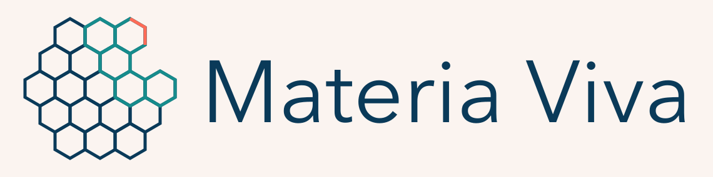
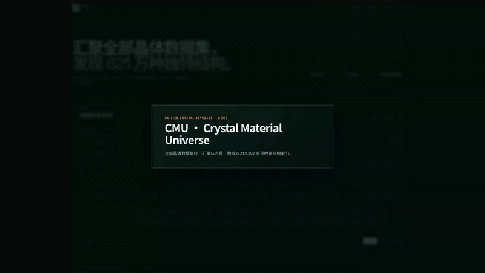

<p align="center">
  
</p>

# MateriaViva

**English** · [简体中文](README.zh-CN.md)

[](https://github.com/AI4QC/materia-viva/actions/workflows/ci.yml)
[](https://huggingface.co/datasets/AI4QC/MateriaViva)

> **Materials discovery should not begin with calling one database API after another and juggling
> a separate account for each.** MateriaViva delivers a unified, deduplicated, licence-reviewed
> snapshot behind a single Hugging Face download.
>
> **MateriaViva is also not meant to stay a one-off collection.** The next stage builds an
> auditable self-evolving loop that keeps discovering new databases and new versions of existing
> ones, then runs admission checks, field mapping and structural deduplication. Automatic
> discovery and integration are still under development and not yet live.

## About MateriaViva

### The problem: there is plenty of materials data, and materials are still hard to find

Crystal structures are not scarce. What is missing is a materials space you can search, compare
and trace back to its source directly.

The same crystal often appears in several databases under different IDs, fields, units and file
formats. Researchers end up requesting accounts one by one, calling bulk APIs, downloading
archives, cleaning data, and then working out which records are merely duplicate structures,
intermediate relaxation frames or molecular-dynamics trajectories. Even after all that, property
fields may be disconnected from the structures, and licence boundaries still have to be checked
again.

The result: the data already exists, but a large share of the time goes into acquiring and
tidying it before any candidate screening begins.

### How we address it

MateriaViva first replaces scattered bulk APIs and per-source account logins with a versioned
Hugging Face snapshot, then organises crystal data into one searchable, traceable entry point.
Researchers start from the periodic table to pick a chemical space, narrow results with
Materials Project style property conditions, and finally inspect structures in the browser in 3D
or through OVITO/Tachyon.

| The old obstacle | How MateriaViva handles it |
|---|---|
| Every database has its own API, account and download flow | Redistributable data is published as one versioned Hugging Face snapshot |
| CIF, JSON, SQL, LMDB and property tables cannot be mixed directly | Structures enter a unified schema; source properties keep their original values, units and provenance |
| The same structure repeats across databases, and trajectory frames inflate material counts | Only unique periodic structure endpoints are accepted, deduplicated by structural fingerprint |
| Experimental structures and computational candidates get mixed together | The two record classes stay separately labelled, filtered and counted |
| The boundary between commercial and open data is unclear | Licence review precedes publication; restricted data never enters the public package |
| After downloading, there is still no convenient way to inspect anything | Periodic-table search, combined filters, interactive 3D and high-quality offline rendering in one interface |

The unified index currently contains:

| Experimental structures | Computational candidates | Unified search records |
|---:|---:|---:|
| 357,127 | 13,186,150 | 13,543,277 |

On top of the structure pool sits a cross-database property layer: **121,620,776 property
rows** covering **166 distinct properties** from **54 integrated source databases**, with
every value keeping its source database, native record id and calculation / measurement
method; 12,812,918 materials carry at least one cross-database property, and **1,190,447
structures are contributed by two or more source databases** — that overlap is what
deduplication buys you. Non-scalar data — **1,198,897 stored spectra** (band structures,
phonon / electronic DOS, powder XRD, XAS, Raman, IR, thermal conductivity) plus on-demand
simulated XRD for every structure — lives in a parallel curve store. Space groups cover
99.996% of the pool. Non-conventional crystal classes (MOF, COF, zeolite, molecular
crystal, 2D material, carbon allotrope, …) are labelled and filterable.
See [`docs/property-integration.md`](docs/property-integration.md).

These figures are a snapshot; `curl -s http://127.0.0.1:8000/api/stats` on a running
instance is authoritative.

### Integrated databases

The unified index is assembled from the databases below: those that ship structures are merged into
the pool after structural fingerprint (BAWL / entalpic fingerprint) deduplication, while the
properties-only sources — ICSD among them — annotate materials that are already in it and add no
structures of their own. The pool starts from the deduplicated base merge —
[LeMat-BulkUnique](https://huggingface.co/datasets/LeMaterial/LeMat-BulkUnique) and the ELEMENTA
relaxed endpoints among them, every record keeping its own `immutable_id` and fingerprint — and
each database below then attaches to it by authoritative record id or by fingerprint, with
fingerprint misses admitted as new structures. **1,190,447 structures are contributed by two or
more source databases** — each of them one row here carrying every contributor's numbers and
provenance, instead of a handful of near-duplicate entries to reconcile by hand.

**54 source databases, 121,620,776 property rows:**

| Group | Databases | Property rows | Largest members |
|---|---:|---:|---|
| Large general-purpose DFT databases | 12 | 108,966,009 | Alexandria, AFLOW, ELEMENTA, OQMD, GNoME, Materials Project |
| Experimental structure catalogues | 2 | 611,908 | COD, ICSD |
| Specialised property libraries | 28 | 1,823,909 | Materiae, CMR, SNUMAT, phonix, Materials Cloud Archive |
| Porous and framework materials | 12 | 10,218,950 | Boyd–Woo carbon capture, Deem zeolites, hMOF, QMOF |

> ⚠️ **Four sources restrict redistribution: AFLOW, ELEMENTA, GNoME and ICSD.** They are
> searchable in an index you build locally, but they are filtered out before any public release —
> AFLOW's academic terms and the CC BY-NC licences of ELEMENTA and GNoME would make a combined
> snapshot non-commercial, and ICSD data may only be held by someone with their own FIZ Karlsruhe
> licence.
>
> **ICSD contributes no structures at all.** Its adapter is properties-only: it annotates pool
> materials with chemical and mineral names and calculated densities, and its 73,823 `origin`
> refs are provenance pointers marking pool materials that correspond to an ICSD collection code
> — not structures admitted from FIZ Karlsruhe. No FIZ structure is stored or published here.

<details>
<summary><b>All 54 databases in detail</b> — what each one contributes, its property rows and its licence</summary>

<br>

#### Large general-purpose DFT databases — 12 sources, 108,966,009 property rows

| Database | Contributes | Property rows | Licence |
|---|---|---:|---|
| [Alexandria](https://alexandria.icams.rub.de/datasets.html) | PBE / PBEsol / SCAN 3D, 2D and 1D crystals: formation and hull energies, indirect and direct gaps, magnetization | 60,588,138 | Alexandria dataset terms |
| [AFLOW](https://aflow.org/documentation/) ⚠️ | high-throughput formation enthalpies, gaps, total energies, prototype labels, density | 18,464,119 | AFLOW academic non-commercial terms |
| [ELEMENTA / ELEMENTA Spin](https://huggingface.co/datasets/kairosmaterial/ELEMENTA) ⚠️ | per-endpoint total energies over the 2,005,836 relaxed endpoints it brought to the base merge; the spin runs add magnetization | 8,023,344 | CC BY-NC 4.0 |
| [OQMD](https://oqmd.org/download/) | one converged calculation per entry: formation energy, hull distance, gap, magnetization | 6,086,500 | CC BY 4.0 |
| [GNoME](https://github.com/google-deepmind/materials_discovery/blob/main/DATASET.md) ⚠️ | formation and decomposition energies, gaps, plus an r2SCAN re-computed subset | 4,897,901 | CC BY-NC 4.0 |
| [Materials Project](https://docs.materialsproject.org/downloading-data/how-do-i-download-the-materials-project-database) | PBE(+U) gaps, energetics and stability, VRH moduli, dielectric / piezoelectric constants, electrode voltages and capacities, surface and grain-boundary energies, oxidation states | 4,291,860 | Materials Project terms |
| [JARVIS-QETB](https://jarvis.nist.gov/) | tight-binding energies and gaps over a fitting set full of deliberately non-equilibrium geometries; every row keeps its "QETB (tight-binding)" method string | 2,524,250 | NIST/JARVIS dataset terms |
| [Matbench Discovery / WBM](https://figshare.com/articles/dataset/Matbench_Discovery_v1_0_0/22715158) | MP2020-corrected formation and hull energies, PBE gaps; its MP-2023 snapshot also bridges legacy numeric `mp-` ids into the match map | 1,734,187 | CC BY 4.0 |
| [JARVIS-DFT 3D](https://pages.nist.gov/jarvis/databases/) | OptB88vdW / TBmBJ / HSE06 gaps, VRH moduli, Seebeck and power factor, DFPT piezoelectrics, SLME, spillage, exfoliation energies | 1,569,924 | NIST/JARVIS dataset terms |
| [Carolina Materials Database](https://www.carolinamatdb.org/) | ML-generated hypothetical crystals with formation energy and space group | 428,272 | CC BY 4.0 |
| [ODBX](https://odbx.science/) | CAMD formation energies and hull distances | 287,006 | ODBX provider terms and source-dataset provenance |
| [Materials Cloud MC3D](https://mc3d.materialscloud.org/) | PBEsol-relaxed 3D crystals linked to their experimental parents | 70,508 | Materials Cloud record licence |

#### Experimental structure catalogues — 2 sources, 611,908 property rows

| Database | Contributes | Property rows | Licence |
|---|---|---:|---|
| [COD](https://wiki.crystallography.net/howtoobtaincod) | as-published experimental CIFs with chemical and mineral names and the temperature and pressure of the measurement | 354,350 | CC0 |
| [ICSD](https://icsd.products.fiz-karlsruhe.de/) ⚠️ | chemical and mineral names and calculated densities, annotated onto pool materials; properties only, no structures | 257,558 | FIZ Karlsruhe ICSD licence |

#### Specialised property libraries — 28 sources, 1,823,909 property rows

Electronic, optical and topological (5 sources, 1,221,398 rows):

| Database | Contributes | Property rows | Licence |
|---|---|---:|---|
| [Materiae](https://cmpdc.iphy.ac.cn/materiae/) | SOC / NSOC topological classes, symmetry indicators, DOS gaps, band structures | 589,993 | Materiae site terms; cite Zhang et al., Nature 566, 475-479 (2019) |
| [CMR static collections](https://cmr.fysik.dtu.dk/) | GLLB-SC gaps and derivative discontinuities, perovskite heats of formation, OQMD-linked energetics, low-dimensionality labels | 305,346 | CC BY-SA 4.0 |
| [SNUMAT](https://figshare.com/articles/dataset/21713885) | GGA and HSE06 electronic and optical gaps, magnetic ordering | 170,893 | Figshare record licence |
| [Materials Cloud Archive static datasets](https://archive.materialscloud.org/) | SHG coefficients, refractive index and birefringence, HSE / LDA gaps, TQC topology classes, electride ELF | 143,153 | record-specific open licences, predominantly CC BY 4.0 |
| [OMDB-organic](https://omdb.mathub.io/dataset/) | organic molecular-crystal gaps | 12,013 | OMDB terms |

Phonons, thermal transport and mechanics (3 sources, 242,300 rows):

| Database | Contributes | Property rows | Licence |
|---|---|---:|---|
| [phonix](https://phonix-db.org/) | lattice thermal conductivity, phonon frequency range, imaginary-mode flags, spectral and cumulative κ curves | 155,192 | CC BY 4.0 |
| [PhononDB (NIMS MDR)](https://mdr.nims.go.jp/collections/8g84ms862?locale=en) | PBEsol DFPT dielectric constants, Born effective charges, harmonic phonon DOS | 86,616 | CC BY 4.0 |
| [HADB](https://hadb.funmat-ii.se/) | hard-coating alloys: elastic moduli from DFT and MLIP at temperature | 492 | HADB terms and source-publication provenance |

Magnetism, superconductivity and ion transport (6 sources, 115,087 rows):

| Database | Contributes | Property rows | Licence |
|---|---|---:|---|
| [NovoMag](https://www.novomag.physics.iastate.edu/structure-database) | magnetic polarization, moments, anisotropy, Curie temperatures | 38,884 | CC BY 4.0 |
| [3DSC](https://github.com/aimat-lab/3DSC) | superconducting critical temperatures matched to crystal structures; properties only | 36,531 | 3DSC repository licence and upstream MP/ICSD terms |
| [SPSE](https://figshare.com/articles/dataset/High-Throughput_Screening_Platform_for_Solid_Electrolytes_Combining_Hierarchical_Ion-Transport_Prediction_Algorithms_/12011412) | BVSE migration barriers and experimental ionic conductivities; properties only | 29,953 | CC BY 4.0 record; underlying ICSD-derived structures retain ICSD terms |
| [SuperBand](https://github.com/ljcj007/SuperBand) | electronic bands, DOS and Fermi surfaces of superconductors | 8,985 | CC BY 4.0 data; MIT software |
| [AMDB](https://altermagnets.anyterial.se/) | altermagnetism screen over MAGNDATA: spin-splitting metrics and screening gap; properties only | 622 | AMDB terms and source-publication provenance |
| [OBELiX](https://github.com/NRC-Mila/OBELiX) | measured room-temperature ionic conductivities; properties only | 112 | CC BY 4.0 |

Two-dimensional and layered materials (5 sources, 71,615 rows):

| Database | Contributes | Property rows | Licence |
|---|---|---:|---|
| [2DMatPedia](https://www.2dmatpedia.org/download) | monolayers derived from bulk parents: gaps, exfoliation energies | 30,583 | 2DMatPedia terms |
| [C2DB](https://2dhub.org/) | computational 2D materials: gaps, work functions, stability | 14,120 | CC BY-SA 4.0 |
| [Materials Cloud MC2D](https://mc2d.materialscloud.org/) | exfoliable monolayers and their interlayer binding energies | 13,202 | Materials Cloud record licence |
| [BiDB](https://www.2dhub.org/bidb/bidb.html) | van der Waals bilayers: stacking-resolved binding energies and gaps | 9,405 | 2DHub dataset terms |
| [OpenMX 2D AB2](https://www.openmx-square.org/2d-ab2/) | AB2 monolayer prototypes and their electronic structure | 4,305 | OpenMX database and source-publication terms |

Minerals, prototypes and other specialised sets (9 sources, 173,509 rows):

| Database | Contributes | Property rows | Licence |
|---|---|---:|---|
| [CSLLM negatives](https://doi.org/10.6084/m9.figshare.29086931) | `predicted_synthesizable=false` labels from a PU screen; properties only, and a missing row is not a prediction of synthesizability | 98,303 | CC BY 4.0 |
| [JARVIS specialized datasets](https://pages.nist.gov/jarvis/databases/) | NIST JARVIS specialized crystal endpoint and property sets | 26,154 | NIST/JARVIS dataset terms |
| [AMCSD](https://www.rruff.net/about/download-data/) | experimental mineral structures with mineral names, measured densities and calculated diffraction patterns | 24,639 | AMCSD terms |
| [SACADA](https://www.sacada.info/) | carbon allotropes: density, hardness, moduli, relative energies | 10,349 | SACADA site terms and source-publication provenance |
| [AFLOW prototype encyclopedia](https://aflowlib.duke.edu/p/index.html) | prototype and Strukturbericht labels; properties only | 6,251 | Apache-2.0 |
| [Webmineral](https://webmineral.com/) | species-level mineral compilations — density, Mohs hardness, refractive index; properties only, and the values describe the species rather than the matched specimen | 4,698 | Webmineral site and cited-source terms |
| [HEX high-pressure elements](https://springernature.figshare.com/collections/HEX_a_complete_Database_of_High-Pressure_Elemental_Crystal_Structures/7119778/1) | elemental crystal structures from 0 to 300 GPa | 1,456 | CC0 |
| [RRUFF](https://www.rruff.net/about/download-data/) | measured mineral chemistry with Raman, infrared and diffraction spectra | 1,302 | RRUFF terms and source-citation provenance |
| [TCOD](https://www.crystallography.net/tcod/) | DFT gaps in theoretical CIFs | 357 | CC0 |

#### Porous and framework materials — 12 sources, 10,218,950 property rows

| Database | Contributes | Property rows | Licence |
|---|---|---:|---|
| [Boyd–Woo carbon-capture MOFs](https://archive.materialscloud.org/record/2018.0016/v3) | GCMC CO₂ capture in wet flue gas: uptakes, selectivities, working capacities, heats of adsorption | 5,454,666 | CC BY 4.0 |
| [Deem SLC zeolites](https://mwdeem.org/PCOD/index.html) | hypothetical zeolites with the SLC forcefield run parsed out of the CIF trailers: moduli, directional Poisson ratios, sound velocities, framework density, plus simulated XRD patterns | 2,977,166 | CC BY 4.0 |
| [hMOF](https://figshare.com/articles/dataset/15127758) | hypothetical MOFs: CO₂ uptake and zeo++ pore geometry | 892,486 | Figshare record licence |
| [QMOF](https://github.com/Andrew-S-Rosen/QMOF) | DFT-relaxed MOFs: multi-functional gaps, total energy, magnetization, LCD / PLD | 339,443 | CC BY 4.0 |
| [FAIR-MOFs](https://zenodo.org/records/13254307) | experimental CSD-derived MOFs: porosity, RCSR topology, bond-dissociation energies | 277,454 | CC BY 4.0 |
| [CoRE MOF 2019](https://zenodo.org/records/3677685) | curated experimentally reported MOFs: Zeo++ porosity, surface area, void fraction, pore volume | 155,488 | CC BY 4.0 |
| [MOFX-DB](https://mof.tech.northwestern.edu/databases) | CoRE MOF / IZA / ToBaCCo subsets: pore geometry and single-gas uptakes near 298 K, 1 bar | 87,845 | MOFX-DB dataset terms |
| [PCOD](https://www.crystallography.net/pcod/) | GRINSP-predicted frameworks — silicates, phosphates, borates and more: prediction R factor and framework density | 24,416 | public domain |
| [EC-MOF](https://ec-mof.njit.edu/) | electrically conductive 2D MOFs: gaps, formation and binding energies | 7,848 | EC-MOF site terms and source-publication provenance |
| [Open-framework aluminophosphates](https://figshare.com/articles/dataset/Database_of_Open-Framework_Aluminophosphate_Structures/7822574) | AlPO frameworks with IZA codes and published refinement residuals | 925 | CC BY 4.0 |
| [CURATED-COFs](https://github.com/lipelopesoliveira/curatedCOFs) | synthesized covalent organic frameworks with their framework names | 684 | repository licence |
| [IZA-SC](https://www.iza-structure.org/databases/) | the approved zeolite framework types as DLS76-idealized pure-silica geometries, not experimental cells | 529 | IZA Structure Commission terms |

</details>

Deduplication and source-priority rules are in section 7 of
[`docs/dataset-acquisition.md`](docs/dataset-acquisition.md); what each source contributes and how
it matches onto the pool is in section 2 of
[`docs/property-integration.md`](docs/property-integration.md). Licence-restricted sources such as
ICSD follow the copyright and redistribution boundary below: usable locally for unified search,
while protected original files and fields are not published with the snapshot.

[](demo/MateriaViva_demo_2K60.mp4)

<p align="center"><a href="demo/MateriaViva_demo_2K60.mp4">Play the full 2560×1440 · 60 FPS demo video</a></p>

## MateriaViva is more than putting files side by side

- Experimentally synthesizable structures and computational candidates carry separate labels, so
  candidate counts never stand in for experimental coverage.
- Only static periodic structure endpoints enter the structure pool. Relaxation, rattled,
  molecular-dynamics and reaction-path intermediate frames do not count as new materials.
- Deduplication does not mean discarding data. After structures are merged, every source keeps
  its original ID, version, properties, units, licence and provenance.
- Raw archives exist for auditing and rebuilding; the site only reads the validated unified index
  rather than mixing source files directly.
- Data without explicit open redistribution permission never appears in the public Hugging Face
  release.

## A self-evolving materials integration database

The long-term goal is not to maintain a one-off static collection, but to keep discovering new
materials databases and new versions of existing sources, then publish a new unified snapshot
after licence judgement, format mapping, structural deduplication and quality checks.

> [!IMPORTANT]
> Automatic discovery and integration are not implemented yet. All 106 catalogued sources are still
> found and reviewed manually, then ingested by resumable acquisition scripts. This README keeps
> planned capabilities separate from what is implemented today.

The intended loop is:

```text
discover a new source or version
        ↓
check licence, access mode, static structure scope and trajectory contamination
        ↓
generate or recommend an acquisition and field-mapping adapter
        ↓
unify format, units and provenance
        ↓
deduplicate by structural fingerprint and merge cross-database properties
        ↓
integrity and outlier checks + human approval
        ↓
publish a new Hugging Face snapshot and change report
```

Failure records and manual corrections feed the next round of source identification, field
mapping and deduplication strategy. The process never bypasses accounts, paid licences or
redistribution limits; data whose authorization cannot be confirmed stays unpublished by default.

## One download instead of scraping a hundred databases

At the publication layer, MateriaViva removes the pattern where every user separately calls
traditional bulk APIs or logs into source accounts. The index is published as a Hugging Face
dataset with versions, hashes, a source manifest and a licence manifest:

### [Hugging Face Dataset · AI4QC/MateriaViva](https://huggingface.co/datasets/AI4QC/MateriaViva) (private)

**This repository is private, and it is not the open-redistribution snapshot.** It carries the
complete working index, including sources whose terms restrict redistribution — ICSD (FIZ
Karlsruhe, per-subscriber licence), and the CC BY-NC / academic-terms sources ELEMENTA, GNoME and
AFLOW. Access is granted per person. A public snapshot would first have to drop those sources;
every property row records its `source_id`, so that filter is one `WHERE` clause, but it has not
been applied to what is published here.

**Code lives on GitHub, data lives on Hugging Face.** The GitHub repository holds only code, data
schemas, the source catalog, documentation, tests and demo assets — no database files, unified
index, render cache or partial downloads. Two index variants are published:

| Variant | Size | What it is for |
|---|---:|---|
| `index/` | ~47 GB | the full index, what the site serves |
| `slice/` | ~tens of MB | developing the web UI without the full download |

The slice is **not** a random sample. It is a greedy set cover chosen so that every source, every
property name, every curve type and every material family appears at least once. A random
thousand rows out of thirteen million would miss almost every rare property, which is exactly the
set of UI panels most likely to be broken — see [`scripts/export_slice.py`](scripts/export_slice.py).

### Copyright and redistribution boundary

MateriaViva's own code is released under [CC BY-NC 4.0](LICENSE) and permits non-commercial use
only. The integrated data carries the terms of its sources, which are stricter.

- Data that clearly permits redistribution — CC0, CC BY, CC BY-SA, CC BY-NC — may enter the public
  snapshot while keeping its original authors, versions, licences and citation requirements.
- Commercial licences, paid subscriptions, institutional licences, account-term restrictions and
  databases without explicit redistribution permission are not open-sourced.
- For restricted sources only the database name, official link, public metadata, source ID and
  licence status are published, never the protected structures, property fields or raw files.
- A unified format does not change who owns the rights to the original data. Any future automatic
  discovery flow must clear the same licence gate first.
- The snapshot includes CC BY-NC 4.0 sources such as ELEMENTA, so the integrated result must not
  be used commercially. ShareAlike sources require a separate compatibility check against the NC
  terms before they can enter the public snapshot.

## Current coverage

The machine-readable catalog registers **106** crystal structure or property sources, of which
**54 are integrated** into the index and contribute the property rows counted above. "Registered"
is not the same as "acquired", and "acquired" is not the same as "integrated": a source can be
downloaded and still be waiting for an adapter, or be evaluated and deliberately rejected —
Catalysis-Hub is in the catalog with a status recording that its crawl omitted the
`reactionSystems` join key, leaving 91% of its reactions unattachable.

Per-source status lives in [`scripts/datasets/sources.json`](scripts/datasets/sources.json) — each
entry's `status` field says exactly where it stands, which is the only place that stays correct as
sources move between those states.

ELEMENTA is a trajectory dataset, but it is ingested under the "one endpoint per relaxation" rule,
so intermediate frames never enter the structure pool.

Full sources, licences, download status and required manual steps are in
[`docs/dataset-acquisition.md`](docs/dataset-acquisition.md). Existing SSD data and its duplicate
relationships are in [`docs/legacy-ssd-data-inventory.md`](docs/legacy-ssd-data-inventory.md).

## Getting the code and data

```bash
git clone https://github.com/AI4QC/materia-viva.git
cd materia-viva
pip install -r backend/requirements.txt

# a small slice — enough to develop the interface against
python scripts/fetch_index.py slice
python scripts/serve.py --runtime data/slice

# or the full index (~47 GB; the download needs roughly double that free,
# because the hub cache holds a second copy until the files are linked)
python scripts/fetch_index.py full
python scripts/serve.py --runtime data/index
```

Then open <http://127.0.0.1:8000>. `--runtime` takes any directory holding `materials.sqlite`,
`structures.blob` and `curves.blob`, so switching between the slice and the full index is a
command-line argument, not a rebuild.

If the data already sits on another volume, link it in instead of downloading:

```bash
export MV_DATA_ROOT=/path/on/ssd/materia-viva-data
ln -s "$MV_DATA_ROOT" data
```

Neither `data` nor its compatibility entry `runtime` is under Git. Raw archives, the SQLite/blob
index, `.part` files, receipts, render caches and local keys stay out of commits too. The expected
layout is:

```text
data/
├── sources/                 per-dataset structure exports
├── index/                   full index: materials.sqlite + structures.blob + curves.blob
├── slice/                   development slice, same three files
├── manifests/               Crystal Record v1 validation reports
└── raw/                     source archives and provenance
```

Current counts are not written here, because every hardcoded figure in this project has gone
stale at least once. Ask the running instance instead:

```bash
curl -s http://127.0.0.1:8000/api/stats
```

Local SSD migration and legacy path compatibility are described in
[`docs/storage-layout.md`](docs/storage-layout.md).

## Unified data format

Structure master records entering MateriaViva use `Crystal Record v1`:

```text
index,material_id,cif,pbes_gap
```

A streaming validator checks field order, data types, non-empty constraints and split counts.
Source-specific properties are kept as sidecars, then mapped into unified SQLite property columns
or JSON extension fields. Original values, units and sources are never overwritten.

- Format description: [`docs/data-format.md`](docs/data-format.md)
- JSON Schema: [`schemas/crystal-record-v1.schema.json`](schemas/crystal-record-v1.schema.json)
- Serving index: `data/index/materials.sqlite` + `data/index/structures.blob`

SQLite stores search fields and compressed block offsets; the blob stores zlib-compressed CIFs in
order. The indexer streams the source CSVs and never needs to load everything at once.

## Install and run

Requires Python 3.10+ and Node.js 20+:

```bash
python -m venv .venv
source .venv/bin/activate
python -m pip install --upgrade pip
python -m pip install -r backend/requirements.txt

cd frontend
npm ci
cd ..
```

OVITO is best kept in its own Python environment:

```bash
export MATERIALS_OVITO_PYTHON=/path/to/ovito-enabled/python
```

Without OVITO configured, interactive 3D still works in the browser, but server-side Tachyon image
rendering is unavailable.

Validate all 13,077,781 published records and build the index (rebuild the property layer afterwards with scripts/properties/run_all.py):

```bash
make validate-data
python scripts/build_index.py
```

A small sample can be built during development. Only skip the source scan when the source data has
already passed full validation separately:

```bash
python scripts/build_index.py \
  --limit-per-dataset 1000 \
  --skip-source-validation \
  --output /tmp/cmu-sample-index
```

Start the site once the build finishes:

```bash
make build

MATERIALS_OVITO_PYTHON=/path/to/ovito-enabled/python \
  python scripts/serve.py --host 0.0.0.0 --port 8000
```

- Site: `http://127.0.0.1:8000`
- API docs: `http://127.0.0.1:8000/api/docs`
- Health check: `http://127.0.0.1:8000/api/health`

The index is written to `.building` temporary files first and swapped atomically on completion, so
an interruption never damages the index currently being served.

## Interface language

The site renders in English by default and switches to Chinese from the header control next to the
theme toggle. The choice is stored in `localStorage` under `mv-lang` and reflected on the document
`lang` attribute. All copy lives in `frontend/src/i18n`, where the English and Chinese dictionaries
share one `TranslationKey` union, so a missing translation is a type error rather than a silent
fallback.

## Testing

```bash
make test
make build
```

Run individually:

```bash
PYTHONPATH=backend:. python -m pytest backend/tests -q
cd frontend
npm test -- --run
npm run typecheck
npm run build
```

With a real index and OVITO connected, browser acceptance can be run:

```bash
python scripts/browser_smoke.py
```

## Repository layout

```text
materia-viva/
├── backend/                 FastAPI, SQLite queries, structure parsing and OVITO rendering
├── frontend/                React, TypeScript, Vite and the interactive crystal workbench
├── scripts/                 validation, indexing, acquisition, serving and demo recording tools
├── schemas/                 Crystal Record v1 JSON Schema
├── docs/                    data, migration, acquisition and design documentation
├── demo/                    2K60 demo video, animated preview and cover
└── data/                    local data link, not under Git
```

## Demo video

- [Animated preview](demo/MateriaViva_demo_preview.gif): 800×450, click to play the full video.
- [2K60 MP4](demo/MateriaViva_demo_2K60.mp4): 2560×1440, 60 FPS, H.264 High.
- [2K cover](demo/MateriaViva_demo_2K60_cover.png).
- `demo/MateriaViva_demo_2K_source.webm`: the raw browser screen recording.

To re-record and transcode:

```bash
python scripts/record_demo.py
ffmpeg -y -i demo/MateriaViva_demo_2K_source.webm \
  -vf "minterpolate=fps=60:mi_mode=blend" \
  -c:v libx264 -profile:v high -level:v 5.1 -preset slow -crf 13 \
  -pix_fmt yuv420p -movflags +faststart -an \
  demo/MateriaViva_demo_2K60.mp4

# generate the animated preview for the GitHub README
ffmpeg -y -ss 1 -i demo/MateriaViva_demo_2K60.mp4 \
  -filter_complex "fps=5,scale=800:-1:flags=lanczos,split[s0][s1];[s0]palettegen=max_colors=72:stats_mode=diff[p];[s1][p]paletteuse=dither=bayer:bayer_scale=5:diff_mode=rectangle" \
  -loop 0 demo/MateriaViva_demo_preview.gif
```

## Licence, contributing and citation

MateriaViva is released under [CC BY-NC 4.0](LICENSE) and permits non-commercial use only.
External databases keep their own licences and citation requirements. Do not redistribute raw
fields from restricted sources such as ICSD or CSD just because a structure has been normalised or
matches an open source.

- Development and source submissions: [`CONTRIBUTING.md`](CONTRIBUTING.md)
- Citing the project: [`CITATION.cff`](CITATION.cff)
